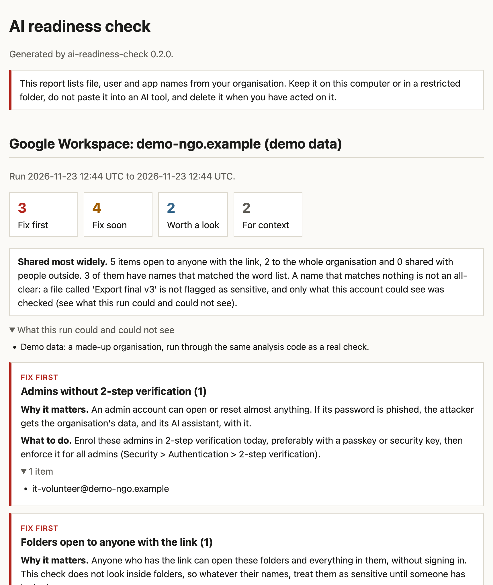

# AI readiness check

A free, read-only check for small humanitarian and civil-society organisations that are about to
switch on, or have already switched on, an AI assistant such as Microsoft 365 Copilot or Gemini.

AI assistants answer from everything a person is allowed to open. In most small organisations,
years of quick sharing mean that is more than anyone thinks: a beneficiary list open to anyone
with the link, salaries open to the whole organisation, a meeting-note bot connected to someone's
calendar. This check finds those things and explains, in plain words, what to fix first.

Early version (0.1). It works, it is small enough to read in an evening, and it needs feedback
from real organisations. Please open an issue with what was useful, wrong or missing.

More background, and a free half-day offer to run it together with small humanitarian and
civil-society organisations: https://coseac.swiss/ai-readiness-check/



## Who it is for

Small humanitarian and civil-society organisations, before they switch on an assistant or
while they decide whether to. Some facts behind that:

- On Google Workspace Business and Enterprise editions, the Gemini app's connection to
  Workspace apps such as Drive and Gmail is on by default
  ([Google](https://knowledge.workspace.google.com/admin/generative-ai/gemini-app/turn-google-apps-in-gemini-on-or-off)).
  Data loss prevention is listed only for Enterprise Standard and Plus in Google's nonprofit
  edition comparison
  ([Google](https://knowledge.workspace.google.com/admin/billing/compare-google-workspace-features-for-nonprofits)).
- On Microsoft 365, free Copilot Chat cannot search your files through Microsoft Graph. It
  uses what people paste or upload, what they have open in Outlook or Teams, and pay-as-you-go
  agents ([Microsoft](https://learn.microsoft.com/en-us/copilot/overview)). Microsoft 365
  Copilot licences can, with each person's own access.
- Microsoft's own oversharing reports (Data access governance, part of SharePoint Advanced
  Management) come with the first assigned Copilot licence, Microsoft says
  ([Microsoft](https://learn.microsoft.com/en-us/sharepoint/sharepoint-advanced-management-features-copilot-license)),
  or with a paid add-on. Microsoft's prerequisites page lists only Enterprise, Education and
  government plans as base subscriptions
  ([Microsoft](https://learn.microsoft.com/en-us/sharepoint/sharepoint-advanced-management-prerequisites)),
  so check on your tenant before relying on it with a Business plan.
- Third-party AI apps that staff connect read whatever they were granted, whatever the licence.

So the check is for the time before that decision, for Google Workspace, and for the apps and
settings those reports do not cover. If you have those reports, use them as well: they cover
every site, and this check does not.

The setup expects someone comfortable with a terminal: an IT person or a volunteer. If nobody
is, use the half-day offer on the project page.

## The rules it follows

- **Read-only.** It asks only for read permissions and sends only GET requests for data.
  It changes nothing in your tenant. (Signing in records your consent to those read permissions;
  the tool prints how to remove it at the end, and the setup guides give the steps.)
- **Enforced by Microsoft and Google, not by trust in this code.** A token with read-only
  permissions cannot change anything, whatever the code does. Read permissions do not stop
  copying, though, which is why there are no dependencies and every request goes through one
  small helper ([airc/http.py](airc/http.py)) that refuses any address that is not Microsoft's
  or Google's, including addresses a server redirects to.
- **Names, not contents.** It reads file names, sharing settings, account settings and connected
  apps. It never opens or downloads a file.
- **Runs on your computer, with your sign-in.** Nobody else gets credentials or admin access.
  Your IT person runs it and keeps the results.
- **Nothing leaves your machine.** The report is written to a local folder. No telemetry.
- **No dependencies.** Python 3.10 or newer and the standard library only, so you can read every
  line before you run it.

## Try it

```
git clone https://github.com/acoseac/ai-readiness-check.git
cd ai-readiness-check
python3 -m airc demo
```

No git? On GitHub, choose Code > Download ZIP, unzip it, and open a terminal in the unzipped
folder. Then run `python3 -m airc demo`.

On Windows, type `py` instead of `python3` (for example `py -m airc demo`). If `py` is missing, install Python from python.org.

`demo` builds a sample report for a made-up organisation, with no sign-in. Open the
`report.html` it prints.

Then, on your own tenant:

```
python3 -m airc google --client client.json     # Google Workspace, see docs/setup-google.md
python3 -m airc m365                            # Microsoft 365, see docs/setup-m365.md
```

Both sign in through your browser. They ask for read-only permissions (listed in each setup
guide) and print how to remove them at the end. `--no-browser` is for a computer with no
browser; `--keywords words.txt` adds your own words (programme or project names, one per line)
to the file-name check.

## What it checks

| Area | Google Workspace | Microsoft 365 |
|---|---|---|
| Files shared with anyone with the link | yes | yes |
| Files open to the whole organisation | yes | yes |
| Files shared with people outside | from the audit log | yes |
| File names that suggest sensitive content (ID documents, beneficiaries, case notes, health, pay, donors, AI meeting notes and transcripts, passwords; English, French, Spanish, Arabic, German) | yes | yes |
| AI and meeting-note apps connected by staff | yes | yes |
| Other apps with access to mail, files or calendars | yes | yes |
| Whether staff can connect apps on their own | manual | yes |
| Outside sharing level | per shared drive (optional) | tenant-wide |
| 2-step verification / MFA | per account | enforcement policy |
| Copilot licences | n/a | yes |
| Device code sign-in blocked | n/a | yes, with Conditional Access (Entra ID P1) |
| Public Microsoft 365 groups and teams | n/a | yes |
| Gemini and Copilot settings | manual | manual |

Each finding is ranked "Fix first", "Fix soon", "Worth a look" or "For context", with why it
matters and what to do. Every report starts with how many files are open to anyone with the
link or to the whole organisation, whatever their names, and what the run could not see. Files
are listed folders first, then most recently changed, and the report ends with how to fix
things without breaking daily work.

What the scripts cannot see is covered by:

- [docs/checklist.md](docs/checklist.md): the manual checks (assistant settings, MFA, site-wide
  access, guidance).
- [docs/staff-guidance-template.md](docs/staff-guidance-template.md): a one-page guide for staff.
- [docs/pre-launch-test.md](docs/pre-launch-test.md): a pre-launch smoke test (ten harmless tests)
  for teams building their own chatbot or agent. It is not red-teaming, and it says when to add
  an automated scanner.

## Suggested use

Half a day with the organisation's IT focal point: run the script together, read the report,
fix the "Fix first" items on the spot, then go through the checklist. The report lists names
from your organisation, so keep it private and delete it when you are done.

## Limits

This version sees what the signed-in account can see, plus (on Google) the audit log for the
last 180 days. On Microsoft 365, admin roles do not open site content, so it checks only the
sites that account is a member or owner of, and Microsoft returns full sharing details only to
an item's owners. It does not cover personal OneDrives or every user's Drive. File names are a
hint, not proof: a sensitive file with a dull name ("Export final v3") will not be flagged, and some
flagged files will be harmless. That is why the report always shows how many files are open by
link, whatever their names, and why folders open to anyone are "Fix first". The setup guides
list the limits for each platform.

## Related tools

For a full settings baseline, run [ScubaGear](https://github.com/cisagov/ScubaGear) or
[Maester](https://maester.dev/) on Microsoft 365, and
[ScubaGoggles](https://github.com/cisagov/ScubaGoggles) on Google Workspace. They check
configuration against security baselines. This check is narrower: it lists the actual files
shared by link or with the whole organisation and the AI apps staff have connected, in plain
language for a small organisation, with no PowerShell modules. Use them together.

## Status and maintenance

A one-person project, built with AI coding assistance under rules set by its author, and tested
by hand against a live Google Workspace and a Microsoft 365 test tenant. Unit tests run on every push
(Python 3.10, 3.12 and 3.13); no live-API test runs automatically, because signing in needs a
person. It uses about a dozen generally available endpoints, so you can see what would break:

- Microsoft Graph v1.0: organization, me, admin/sharepoint/settings, policies/authorizationPolicy,
  policies/identitySecurityDefaultsEnforcementPolicy, identity/conditionalAccess/policies,
  oauth2PermissionGrants, servicePrincipals, subscribedSkus, users, groups, sites, drives (delta
  and permissions).
- Google: Admin SDK Directory v1 (users), Admin SDK Reports v1 (drive and token activity), Drive
  v3 (files, drives), and OpenID Connect userinfo.

## Running the tests

```
python3 -m unittest discover -s tests
```

## Licence

Apache 2.0. See [LICENSE](LICENSE).
